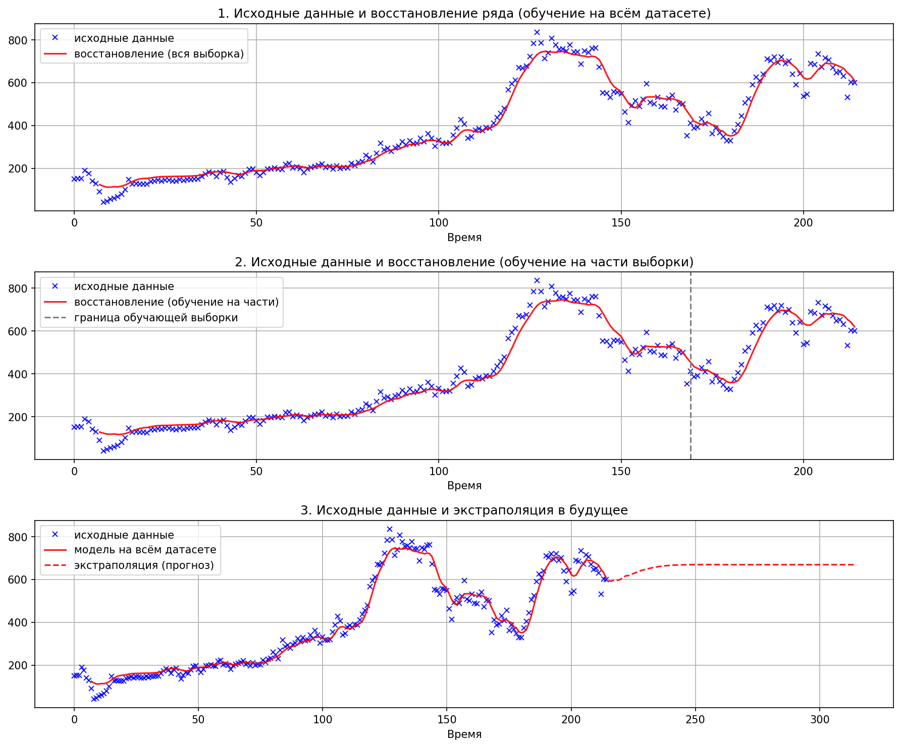
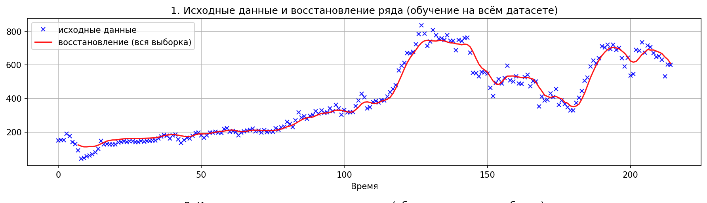
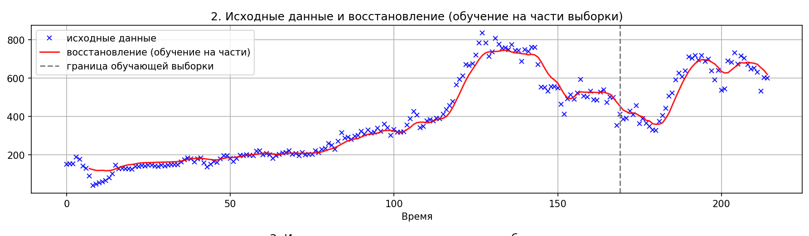
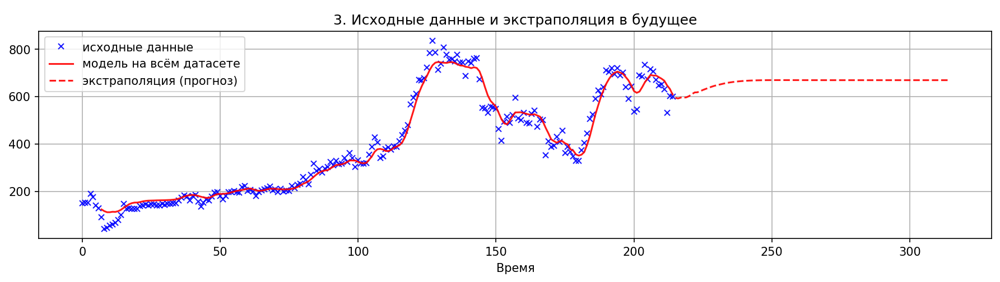
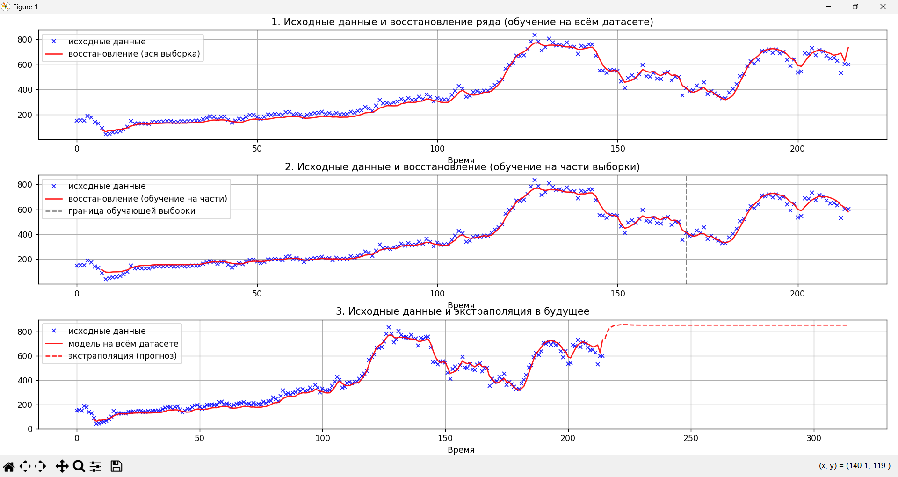
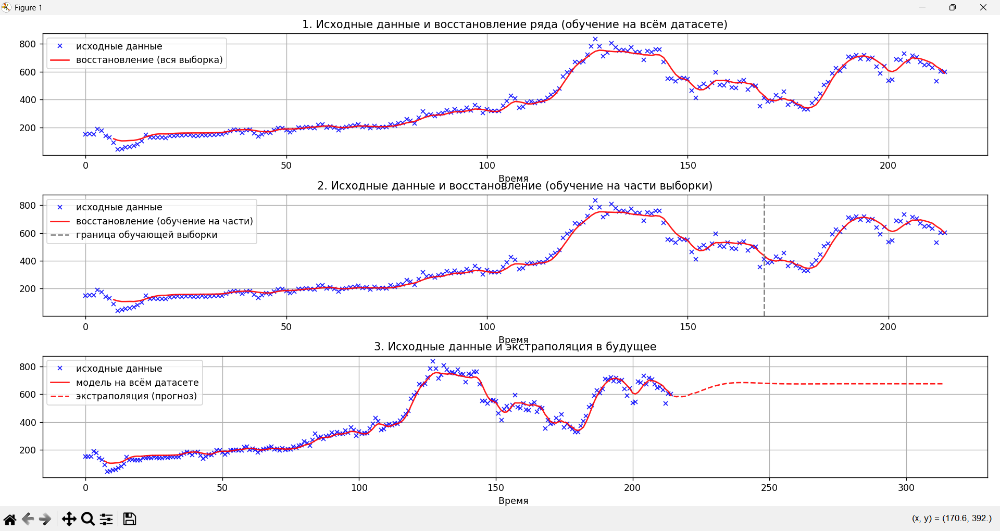
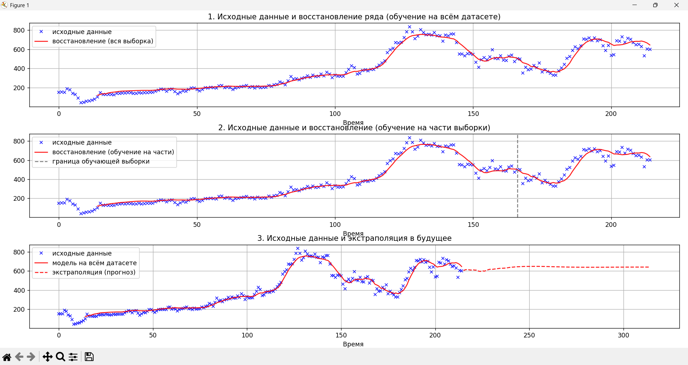

# Extrapolation of Stock Time Series with a Single-Layer Perceptron

Проект реализует **однослойный перцептрон** (входной слой + выходной слой, без скрытых слоёв) для экстраполяции финансового временного ряда - котировок акций ПАО «Татнефть» (`TATN`).

Код написан на Python с векторизацией через NumPy: нормировка ряда, построение датасета скользящим окном с перекрёстными точками, обучение батч-градиентным спуском и визуализация восстановления / прогноза.

---

## Возможности

- загрузка одномерного ряда из Excel (`TATN.xlsx`);
- нормировка значений в диапазон $[\delta, 1-\delta]$ для корректной работы сигмоиды;
- формирование обучающей выборки методом скользящего окна с перекрёстными точками;
- обучение однослойного перцептрона с нейроном смещения;
- восстановление исторического ряда по выходам модели;
- сравнение обучения на всей выборке и на её части;
- итеративная экстраполяция на заданное число шагов вперёд;
- сохранение сводного графика в `images/results_overview.png`.

---

## Структура проекта

```text
.
├── perceptron_time_series_forecast.py   # основной скрипт
├── TATN.xlsx                            # исходный временной ряд
├── images/                              # скриншоты и результаты
├── requirements.txt
├── .gitignore
└── README.md
```

---

## Быстрый старт

```bash
python -m venv .venv
# Windows:
.venv\Scripts\activate
# Linux / macOS:
# source .venv/bin/activate

pip install -r requirements.txt
python perceptron_time_series_forecast.py
```

Основные параметры задаются в начале файла `perceptron_time_series_forecast.py`:

| Параметр | По умолчанию | Смысл |
|---|---|---|
| `N_IN` | `10` | длина входного окна |
| `N_OUT` | `5` | длина выходного окна |
| `N_CROSS` | `3` | число перекрёстных точек |
| `DELTA` | `0.05` | отступ нормировки от краёв `[0, 1]` |
| `LR` | `0.01` | шаг градиентного спуска $\lambda$ |
| `EPOCHS` | `1000` | число эпох обучения |
| `SPLIT_PERCENT` | `80` | доля окон для обучения на части выборки |
| `FUTURE_STEPS` | `100` | число точек прогноза в будущее |

---

## Теория

### 1. Нейрон и функция активации

Искусственный нейрон - базовый вычислительный элемент нейронной сети. Идея заимствована из биологии: выход нейрона зависит от входного сигнала.

Каждый нейрон суммирует входящие сигналы $S_i$, поступающие через синаптические связи:

$$
S = \sum_i S_i \quad (1)
$$

Суммарный сигнал $S$ пропускается через функцию активации $f$, задающую связь между входом и выходом нейрона:

$$
x = f(S) \quad (2)
$$

В проекте используется **сигмоидальная** функция активации:

$$
\sigma(S) = \frac{1}{1 + e^{-S}} \quad (3)
$$

Свойства сигмоиды:

$$
\begin{aligned}
S &\rightarrow +\infty &&\Rightarrow&& \sigma(S) \rightarrow 1, \\
S &\rightarrow -\infty &&\Rightarrow&& \sigma(S) \rightarrow 0, \\
S &= 0 &&\Rightarrow&& \sigma(S) = \frac{1}{2}.
\end{aligned}
$$

Сигмоида плавно переходит из $0$ в $1$, что удобно для градиентного обучения.

Производная сигмоиды выражается через значение самой функции $y = \sigma(S)$:

$$
\sigma'(S) = \sigma(S)\,(1 - \sigma(S)) = y\,(1 - y) \quad (4)
$$

Это свойство важно: производная нигде не равна нулю и по порядку величины сопоставима со значением самой функции - необходимое условие устойчивого градиентного спуска.

---

### 2. Нейронный слой и перцептрон

**Нейронный слой** - совокупность одинаковых нейронов без связей между собой. Каждый нейрон независимо хранит одну компоненту многомерного информационного объекта.

При передаче сигнала от слоя $i$ к слою $j$ каждый нейрон слоя $i$ связан с каждым нейроном слоя $j$. Вес связи обозначается $W_{ij}$. Совокупность всех весов образует матрицу весов $W$.

Входное значение нейрона $j$ - взвешенная сумма выходов нейронов предыдущего слоя:

$$
S_j = \sum_i x_i W_{ij} \quad (5)
$$

Выход нейрона $j$:

$$
y_j = f(S_j) \quad (6)
$$

Чтобы сеть корректно работала при нулевых входах, в слой (кроме выходного) добавляют **нейрон смещения**. Его выход всегда равен $1$, а вес связи с нейроном $j$ обозначается $W_{1ij}$. С учётом смещения:

$$
S_j = \sum_i x_i W_{ij} + 1 \cdot W_{1ij} \quad (7)
$$

Даже при $x_i = 0$ для всех $i$ значение $S_j$ равно обучаемому весу смещения. Смещение сдвигает порог функции активации влево или вправо.

В проекте реализован **однослойный перцептрон**: матрица весов $W$ имеет размерность $(n_{in} + 1) \times n_{out}$, первая строка - веса нейрона смещения. В матричном виде прямой проход:

$$
S = \tilde{X}\, W, \qquad Y = \sigma(S) \quad (8)
$$

где $\tilde{X}$ - матрица входов с добавленным единичным столбцом (нейрон смещения).

---

### 3. Целевая функция и алгоритм обучения

Для каждого элемента датасета $d$ локальная ошибка $\varepsilon_d$ - сумма квадратов отклонений выходов сети от эталонных значений:

$$
\varepsilon_d = \sum_j (x_j^d - t_j^d)^2 \quad (9)
$$

Суммарная целевая функция $E$ - сумма локальных ошибок по всему датасету:

$$
E(W_{ij}) = \sum_d \varepsilon_d \quad (10)
$$

Функция $E$ зависит от всех весов матрицы $W_{ij}$. Для минимизации применяется **батч-градиентный спуск** - обновление весов по всему датасету сразу:

$$
W_{ij}^{new} = W_{ij} - \lambda \frac{\partial E}{\partial W_{ij}} \quad (11)
$$

где $\lambda$ - шаг обучения (learning rate).

Поскольку $E = \sum_d \varepsilon_d$:

$$
\frac{\partial E}{\partial W_{ij}} = \sum_d \frac{\partial \varepsilon_d}{\partial W_{ij}} \quad (12)
$$

Для одного элемента датасета $d$ по правилу цепочки:

$$
\frac{\partial \varepsilon_d}{\partial W_{ij}} = (x_j^d - t_j^d) \frac{\partial x_j^d}{\partial W_{ij}} \quad (13)
$$

Так как $x_j^d = f(S_j^d)$:

$$
\frac{\partial x_j^d}{\partial W_{ij}} = \left.\frac{\partial f}{\partial S}\right|_{S=S_j^d} \cdot x_i^d \quad (14)
$$

Итоговая формула элемента матрицы градиента:

$$
\frac{\partial \varepsilon_d}{\partial W_{ij}} = (x_j^d - t_j^d) \left.\frac{\partial f}{\partial S}\right|_{S=S_j^d} x_i^d \quad (15)
$$

В матричном виде по всему батчу:

$$
\frac{\partial E}{\partial W} = \tilde{X}^{T} \Delta, \qquad \Delta = (Y - T)\, Y\,(1 - Y) \quad (16)
$$

---

### 4. Построение датасета для временного ряда

Датасет формируется методом **скользящего окна**. Для окна, начинающегося в позиции $k$:

- входной вектор $x^d$: точки ряда с позиции $k$ по $k + n_{in} - 1$ (длина $n_{in}$);
- целевой вектор $t^d$: точки ряда с позиции $k + n_{in} - n_{cross}$ по $k + n_{in} - n_{cross} + n_{out} - 1$ (длина $n_{out}$).

Параметр $n_{cross}$ задаёт число **перекрёстных точек** - тех, что одновременно входят во входной и целевой векторы.

При $n_{in} = 10$, $n_{out} = 5$, $n_{cross} = 3$:

$$
\begin{aligned}
\text{вход:} &\quad 1, 2, \ldots, 10, \\
\text{выход:} &\quad 8, 9, \ldots, 13, \\
\text{перекрёстные:} &\quad 8, 9, 10, \\
\text{будущие:} &\quad 11, 12, 13.
\end{aligned}
$$

Ширина одного окна:

$$
n_{window} = n_{in} + n_{out} - n_{cross}
$$

Для выбранных параметров $n_{window} = 12$. Окно сдвигается по ряду с шагом $1$.

Перед подачей в сеть значения нормируются в диапазон $[\delta, 1-\delta]$:

$$
z = \delta + \frac{x - x_{min}}{x_{max} - x_{min}} (1 - 2\delta) \quad (17)
$$

Параметр $\delta = 0.05$ не даёт данным попадать в насыщенные зоны сигмоиды вблизи $0$ и $1$, где градиент мал и обучение замедляется.

Обратная нормировка:

$$
x = \frac{z - \delta}{1 - 2\delta} (x_{max} - x_{min}) + x_{min} \quad (18)
$$

---

## Реализация

1. **Нормировка** - формулы (17)-(18): глобальные $x_{min}$, $x_{max}$, сжатие в $[\delta, 1-\delta]$ и обратный переход в исходную шкалу цен.
2. **Датасет** - скользящее окно с перекрёстными точками; минимальная длина фрагмента $n_{in} + n_{out} - n_{cross}$.
3. **Перцептрон** - матрица $W$ размера $(n_{in}+1) \times n_{out}$, инициализация равномерным распределением на отрезке $[-0.5, 0.5]$.
4. **Прямой проход** - $\tilde{X}$ с bias-столбцом, $S = \tilde{X}\,W$, $Y = \sigma(S)$.
5. **Обучение** - батч-градиентный спуск по формулам (10)-(16), все операции векторизованы.
6. **Восстановление ряда** - усреднение предсказаний по всем окнам, в которые попадает каждая точка.
7. **Экстраполяция** - итеративный прогноз: на каждом шаге последнее предсказание дописывается в ряд и снова подаётся на вход.

---

## Результаты

После загрузки ряда `TATN` (~215 точек) и нормировки в $[0.05, 0.95]$ строится датасет скользящими окнами. Обучение на всём датасете: $1000$ эпох, $\lambda = 0.01$. Целевая функция $E$ монотонно убывает (пример: с $\sim 64$ до $\sim 1.86$) - градиентный спуск сходится корректно.

Сводный график трёх экспериментов:



### Восстановление ряда (обучение на всей выборке)

Синие крестики - исходные котировки, красная линия - восстановление перцептроном. Модель хорошо воспроизводит форму ряда; заметное отставание появляется в зонах резких пиков и провалов (примерно точки $130,\ldots,160$) - ожидаемое ограничение окна фиксированной длины.



### Обучение на части выборки

Серая пунктирная линия - граница обучающей выборки. На отложенной части ряда модель улавливает общий ценовой уровень и направление движений.



### Экстраполяция в будущее

При многошаговом прогнозе ошибка накапливается: модель постепенно начинает опираться на собственные предсказания, поэтому долгосрочный прогноз выходит на плато / квазипериодические колебания. Это ожидаемое ограничение однослойной архитектуры без внешнего контекста.



### Влияние гиперпараметров

**Увеличение шага обучения** $\lambda = 0.1$:



**Увеличение числа эпох** до $2000$:



**Расширение окна** $n_{in} = 20$, $n_{out} = 10$, $n_{cross} = 6$:



---

## Выводы

- Однослойный перцептрон с сигмоидой и нейроном смещения способен восстанавливать общую динамику финансового ряда на исторических данных.
- Краткосрочные предсказания на отложенной части выборки адекватны по уровню цены и направлению движения.
- Долгосрочная рекурсивная экстраполяция накапливает ошибку - ограничение архитектуры, а не только реализации.
- Нормировка в $[\delta, 1-\delta]$, перекрёстные точки в окне и аналитический градиент по формулам (12)-(16) дают устойчивое обучение батч-градиентным спуском.

---

## Стек

- Python 3.10+
- NumPy
- pandas
- matplotlib
- openpyxl
